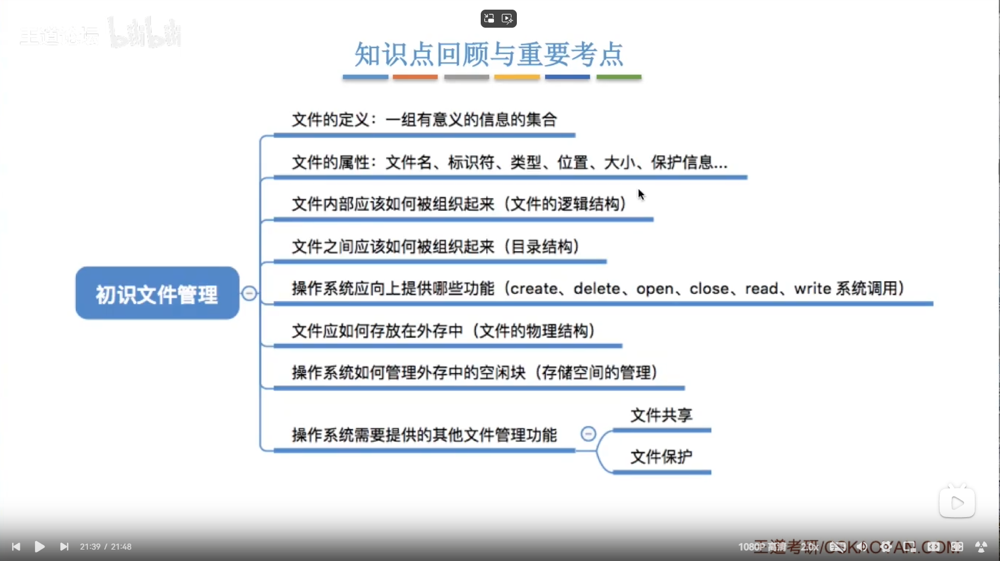
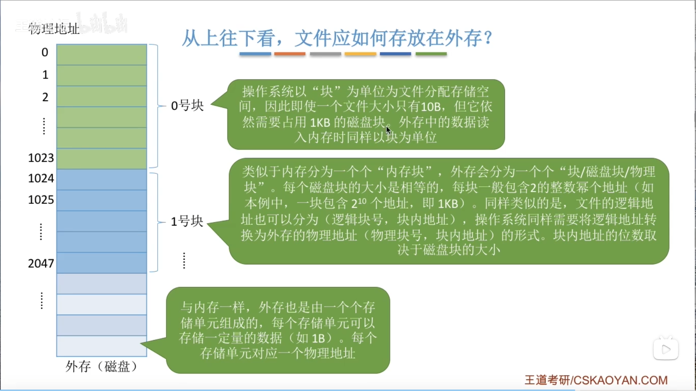
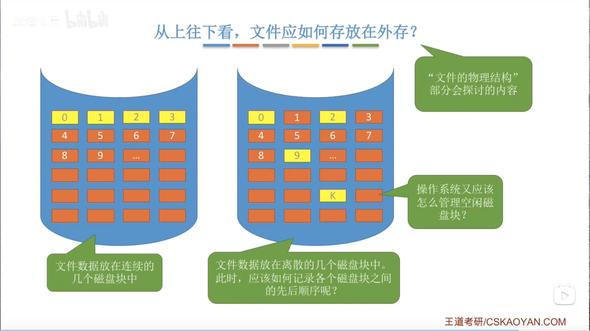
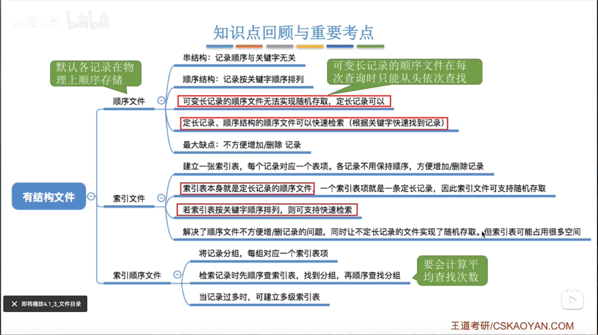
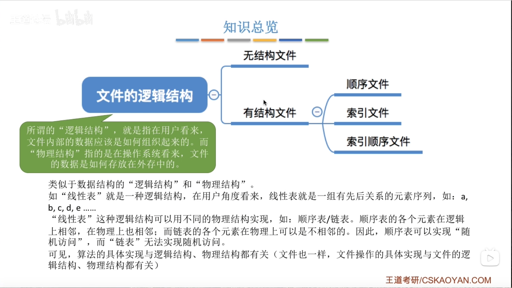
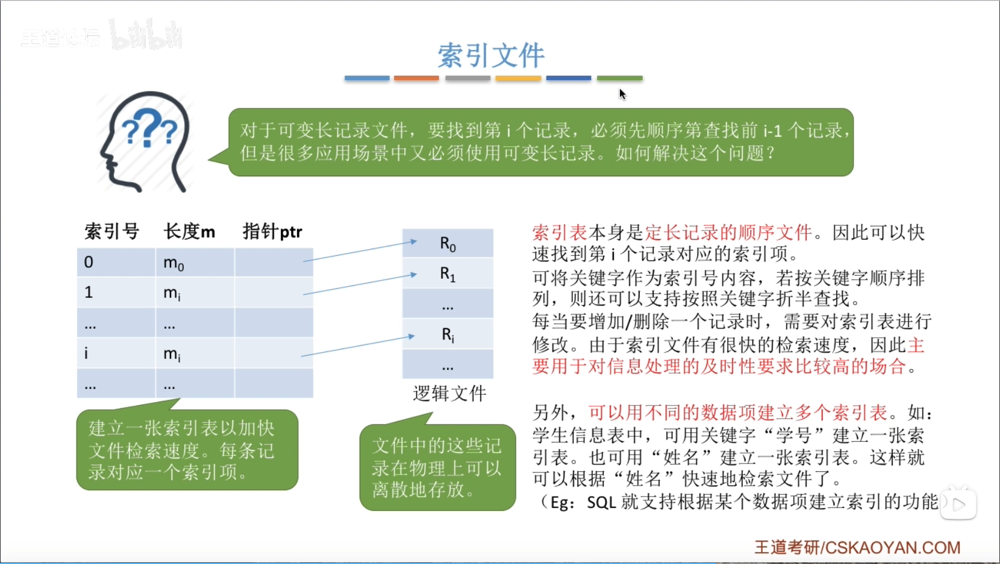
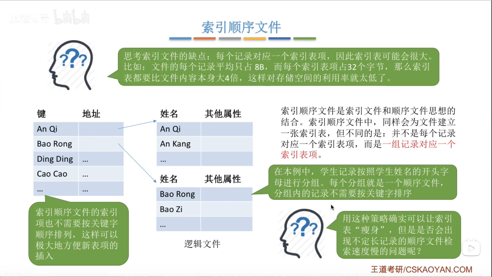
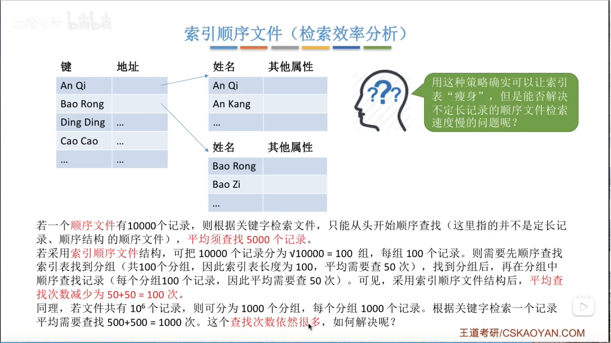
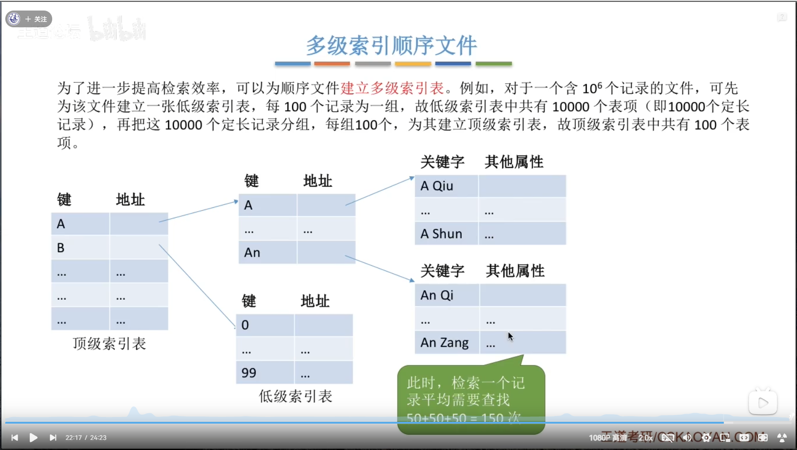

# 文件管理

## 初识文件管理

1. 前情回顾
    - 操作系统作为系统资源的管理者，提供了**处理机管理、存储器管理、文件管理和设备管理**的功能，目标是实现安全和高效。
    - 操作系统作为硬件和用户（应用软件）的中间部分，从下往上看，`os`应该提供哪些功能以供用户（应用程序）方便地使用文件？从上往下看，文件数据应该怎么存放在外存（磁盘）上？
2. 文件的属性（文件定义：一组有意义的信息的集合）
    - 文件名。同一目录下不允许有重名文件；文件名主要是为了用户找到文件
    - 标识符。一个系统内的各**文件标识符唯一**；对用户毫无可读性，只是操纵系统用于区分各个文件的一种内部名称
    - 类型
    - 位置：文件存放的路径（用户使用）；在外存中的位置（操作系统使用）
    - 大小
    - 创建时间、修改时间
    - 文件所有者信息
    - 保护信息：对文件进行保护的访问控制信息
3. 文件内部数据的组织方式——文件的逻辑结构
    - 无结构文件。如文本文件，由一些二进制或字符流组成，又称“流式”文件
    - 有结构文件。如数据库表，由一组**记录**组成，又称“记录式文件”；记录是一组相关**数据项**的集合；**数据项是文件系统中最基本的数据单位**；一般来说，每条记录都有一个数据项可以作为**关键字**（作为识别不同记录的`ID`）
    - 各个记录间应该如何组织（应该顺序存放？还是用索引表来表示记录间的顺序），这是“**文件的逻辑结构**”重点探讨的问题。
    - **目录其实也是一种特殊的有结构文件**（由记录组成）
4. 操作系统应该向上提供哪些功能（对于文件管理）
    - `create`
    - `delete`
    - `read`：从外存读入内存
    - `write`：从内存写入外存
    - `open`：读/写文件之前需要先打开文件
    - `close`：读/写文件之后需要关闭文件
    以上是向上提供的几个最基本功能
5. 文件如何存放在外存——文件的物理结构

    - 操作系统**以块为单位**为文件分配存储空间
    - 外存也是由一个个存储单元组成，**每个存储单元对应一个物理地址**
    - 类似于内存分为一个个“内存块”，外存也会分为一个个“**块/磁盘块/物理块**”，每个磁盘块的大小是相等的，每块一般包含 2 的整数幂个地址。
    - 文件的逻辑地址也可以分为：**（逻辑块号，块内地址）**，操作系统同样需要将逻辑地址转换为外存的**物理地址（物理块号，块内地址）**的形式。其中，块内地址的位数取决于磁盘块的大小。

6. 其他需要由操作系统实现的文件管理功能
   - 文件共享：使多个用户可以共享使用一个文件
   - 文件保护：如何保证不同的用户对文件有不同的操作权限

## 文件的逻辑结构

    - 逻辑结构：在用户看来，文件内部的数据应该是如何组织起来的；物理结构：在操作系统看来，文件的数据是如何存放在内存中的
    - 可以分为无结构文件和有结构文件，其中后者又可以再分为**顺序文件、索引文件、索引顺序文件**

1. 无结构文件：一般由“流”组成（二进制流、字符串流），无显著逻辑结构
2. 有结构文件：
    - 根据各条记录的长度是否相等，可分为定长记录和可变长记录
    1. 顺序文件
        - **在逻辑上**，文件中的记录一个接一个地顺序排
        - 记录可以是定长的，也可以是可变长的
        - 在物理上，各个记录可以**顺序存储或链式存储**
        - 顺序文件又可以分为：**串结构**，记录之间的顺序与关键字无关；**顺序结构**，记录之间的顺序按关键字顺序排列
        - 链式存储时：
            无论是定长，还是可变长记录，都无法实现随机存取，每次只能从第一个记录开始依次往后查找。
        - 顺序存储
            1. 可变长记录：无法实现随机存取，每次只能从第一个记录开始依次往后查找
            2. 定长记录：可以实现随机存取。记录长度为 `L`，则第 `i` 个记录存放的相对位置是 `i * L`；若采用*串结构*，无法快速找到某个关键字对应的记录；若采用*顺序结构*，可以快速找到某关键字对应的记录（如折半查找）
    2. 索引文件

        - **索引表本身是定长记录的顺序文件**
    3. 索引顺序文件

        - 与索引文件不同的是并不是每个记录对应一个索引表项
        - 通过对记录进行分组，每组记录对应一个索引表项（为分组建立索引表）来解决索引表占用空间大的问题
        - 检索效率分析：

        - 当检索效率不满足要求时，可以创建多级索引表
