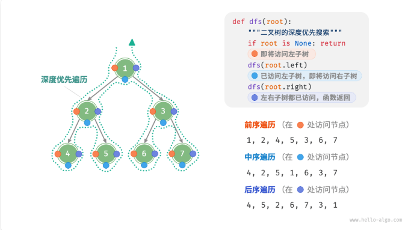
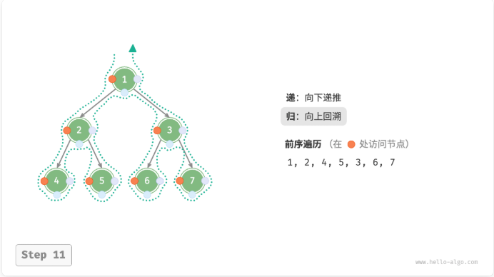

# 树

> [hello算法](https://www.hello-algo.com/chapter_tree/)
> [代码随想录](https://www.programmercarl.com/%E4%BA%8C%E5%8F%89%E6%A0%91%E7%90%86%E8%AE%BA%E5%9F%BA%E7%A1%80.html#%E7%AE%97%E6%B3%95%E5%85%AC%E5%BC%80%E8%AF%BE)

## 二叉树(binary tree)

二叉树是一种**非线性结构**，代表“祖先”与“后代”之间的派生关系，体现了“**一分为二**”的分治逻辑。**基本单元是节点，每个节点包含值、左子节点引用和右子节点引用**。

* 左子树
* 右子树
* 在二叉树中，除叶节点外，**其他所有节点都包含子节点和非空子树**。

```C++
/* C++实现 */
struct TreeNode{
    int val;
    TreeNode *left;
    TreeNode *right;
    TreeNode(int x) : val(x), left(nullptr), right(nullptr){}
};
```

### 二叉树常见术语

1. 根节点（root）
2. 叶节点（leaf）
3. 边（edge）
4. 节点所在的层（level）
5. 节点的度（degree）：节点的子节点的数量。在二叉树中，度的取值范围是0、1、2；
6. 二叉树的高度（height）
7. 节点的深度（depth）
8. 节点的高度（height）

* 高度和深度定义的根据可能有所不同，有的将其定义为“**经过的节点的数量**”，有的将其定义为“**经过的边的数量**”（当前采用）。

### 二叉树基本操作

1. 初始化
2. 插入与删除

### 常见二叉树类型

1. 完美二叉树

   * 所有层的节点都被完全填满；
   * 叶节点的度为 0，其余所有节点的度都为 2
   * **若树的高度为 $h$，则节点总数为 $2^{h + 1} - 1$**
2. 完全二叉树

   * 只有最底层的节点未被填满，且最底层节点尽量靠左填充
   * 完美二叉树也是一颗完全二叉树
3. 完满二叉树

   * 除了叶节点之外，其余所有节点都有两个子节点
4. 平衡二叉树

   * 任意节点的左子树和右子树的高度之差的绝对值不超过 1

### 二叉树的退化

当二叉树的每层节点都被填满时，达到“完美二叉树”；而当所有节点都偏向一侧时，**二叉树退化为“链表”**。

|                              |       完美二叉树       |   链表   |
| :--------------------------: | :--------------------: | :-------: |
|     第$i$ 层的节点数量     |      $2^{i -1}$      |     1     |
| 高度为$h$ 的树的叶节点数量 |       $2^{h}$       |     1     |
|  高度为$h$ 的树的节点总量  |    $2^{h+1} - 1$    |  $h+1$  |
| 节点总数为$ n$ 的树的高度 | $log_{2}(n + 1) - 1$ | $n - 1$ |

## 二叉树遍历

**从物理结构来看，树是一种基于链表的数据结构，因此其遍历方式是通过指针逐个访问节点**。然而，树是一种非线性数据结构，这使得遍历树比遍历链表更加复杂。

### 层序遍历

* 层序遍历本质上属于**广度优先遍历（breadth-first traversal）**，也称**广度优先搜索（breadth-first search, BFS）**。
* 逐层推进
* 广度优先遍历通常借助**队列**来实现。队列遵循“先入先出”的规则，而广度优先遍历则遵循“逐层推进”的规则，**两者背后的思想是一致的**。

```C++
vector<int> levelOrder(TreeNode* root){
    queue<TreeNode *> queue;
    queue.push(root);
    vector<int> res;
    while(!queue.empty()){
        TreeNode *node = queue.front();
        queue.pop();
        res.push_back(node->val);
        if(node->left != nullptr){
            queue.push(node->left);
        }
        if(node->right != nullptr){
            queue.push(node->right);
        }
    }
    return res;
}
```

* 时间复杂度：`O(n)`，所有节点被访问一次，使用 `O(n)` 时间，其中 `n` 为节点数量。
* 空间复杂度：`O(n)`，在最差情况下，即满二叉树时，遍历到最底层之前，队列中最多同时存在 `(n + 1)/2` 个节点，占用 `O(n)` 空间。

### 前序、中序、后序遍历

* 前序、中序和后序遍历都属于**深度优先遍历（depth-first traversal）**，也称**深度优先搜索（depth-first search, DFS）**
* “先走到尽头，再回溯继续”
* 前序、中序和后序按照节点“中左右”中“中”的位置来区分，其中“中”指父节点，“左右”分别指左、右子节点

* 通常采用递归的方式；“递”：表示开启新的方法，“归”：表示函数返回。**要实现递归方式（或者说实现递归的思想）的话还可以用栈 `stack` 作为容器，从而可以将函数的递归调用转换成迭代的关系**。
* 在上述三种深度优先遍历中，前序遍历最好理解。它是在对树中节点进行递归时，在“递”的过程中（若树的根节点在上，叶节点在下，就是从上往下走的过程中），进行节点值的访问的；而在“归”的过程中（即往上返回的时候）是不进行节点值的访问的。

* 也可以将树的遍历过程看作：将树中所有节点按照某一种顺序存入栈中，而这一顺序在前、中、后三种遍历方式中是**不一样的**（尽管从上上图中可以看出它们的路线是一样的，但是由于对节点的访问顺序不一样，因此树中节点被存入栈中的顺序也是不一样的）。~~前序与中序（后序）的最大不同在于：前序访问节点是在往容器中存入该节点时（对应“递”的过程）；而后序和中序是在从容器中取节点的时候~~。与递归调用不同的是，通过将节点存入栈中，既可以在存入时访问节点的值，也可以在节点取出时访问其值。存入时访问的问题是：1. 只能采用边存入边取出的方式，否则无法判断遍历结束；2. 考虑到栈先入后出的特性，以及操作过程：访问当前节点的值（取出），然后先存入该节点的右节点，再存入该节点的左节点，如果采用存入时读取值会导致顺序错乱和重复读取的问题。**使用栈来实现递归，一般是通过栈的 `pop` 操作来获取目标值，而 `push` 操作只是调整了这个获取的过程**。
* 三种方式的递归实现：
```C++
/* 前序遍历 */
void preTraversal(TreeNode* root){
    if(root == nullptr)
        return;
    vec.push_back(root->val);
    preTraversal(root->left);
    preTraversal(root->right);
}

/* 中序遍历 */
void midTraversal(TreeNode* root){
    if(root == nullptr)
        return;
    preTraversal(root->left);
    vec.push_back(root->val);
    preTraversal(root->right);
}

/* 后序遍历 */
void postTraversal(TreeNode* root){
    if(root == nullptr)
        return;
    postTraversal(root->left);
    postTraversal(root->right);
    vec.push_back(root->val);
}
```
时间复杂度：`O(n)`，所有节点被访问一次，使用 `O(n)` 时间，其中 `n` 为节点数量。
空间复杂度：`O(n)`，在最差情况下，即树退化为链表时，递归深度达到 `n`，系统占用 `O(n)` 栈空间（**递归深度与树的深度有关**）。

* 三种方式的迭代实现：
```C++
/* 前序遍历 */
vector<int> preOrderTraversal(TreeNode* root){
    stack<TreeNode*> st;
    TreeNode* cur = root;
    vector<int> res;
    if(cur) st.push(cur);
    while(!st.empty()){
        cur = st.top();
        st.pop();
        res.push_back(cur->val);
        if(cur->right) st.push(cur->right);
        if(cur->left) st.push(cur->left);
    }
    return res;
}
/* 中序遍历 */
vector<int> preOrderTraversal(TreeNode* root){
    stack<TreeNode*> st;
    TreeNode* cur = root;
    vector<int> res;
    while(cur != nullptr || !st.empty()){
        if(cur){
            st.push(cur);
            cur = cur->left;
        }else{
            cur = st.top();
            res.push_back(cur->val);
            st.pop();
            if(cur->right) st.push(cur->right);
        }
    }
}
/* 后序遍历 */
// 前序遍历 中左右 -> 中右左 -> 左右中 后序遍历
vector<int> preOrderTraversal(TreeNode* root){
    stack<TreeNode*> st;
    vector<int> res;
    TreeNode* cur = root;
    if(cur) st.push(cur);
    while(!st.empty()){
        cur = st.top();
        res.push_back(cur->val);
        st.pop();
        if(cur->left) st.push(cur->left);
        if(cur->right) st.push(cur->right);
    }
    reverse(res.begin(), res.end());
    return res;
}
```

* 三种方式的迭代实现——统一形式
```C++
/* 前序遍历 */
vector<int> preOrderTraversal(TreeNode* root){
    vector<int> res;
    TreeNode* cur = root;
    stack<TreeNode*> st;
    if(cur) st.push(cur);
    while(!st.empty()){
        cur = st.top();
        if(cur){
            st.pop();           // 避免栈中节点重复访问
            // 通过栈调整访问顺序
            if(cur->right) st.push(cur->right);
            if(cur->left) st.push(cur->left);
            st.push(cur);
            st.push(nullptr);   // 通过 nullptr 标记决定什么时候访问节点
        }
    }else{
        st.pop();               // 弹出空节点
        cur = st.top();
        res.push_back(cur->val);
        st.pop();               // 弹出访问过的节点
    }
    return res;
}

/* 中序遍历 */
vector<int> midOrderTraversal(TreeNode* root){
    ...
    if(cur){
        st.pop();           // 避免栈中节点重复访问
        // 通过栈调整访问顺序
        if(cur->right) st.push(cur->right);
        st.push(cur);
        st.push(nullptr);   // 通过 nullptr 标记决定什么时候访问节点
        if(cur->left) st.push(cur->left);
    }
    ...
}

/* 后序遍历 */
vector<int> postOrderTraversal(TreeNode* root){
    ...
    if(cur){
        st.pop();           // 避免栈中节点重复访问
        // 通过栈调整访问顺序
        st.push(cur);
        st.push(nullptr);   // 通过 nullptr 标记决定什么时候访问节点
        if(cur->right) st.push(cur->right);
        if(cur->left) st.push(cur->left);
    }
    ...
}
```
  - **栈只是用来调整访问顺序的，需要通过先 push 后 pop 来实现，即访问发生在 pop 后，而不是 push 前**。
  - 还需要**使用一个标记来决定什么时候对节点进行访问**，因为深度遍历的过程中为调整访问次序节点需要**出入栈多次**（首先被当作父节点被 push 到栈中，而后为调整 左右节点的顺序而出栈后又入栈，最后访问时出栈。因此第一次出栈是不需要访问节点的，这个标记放入的时间是节点第二次入栈，且考虑到栈后入先出的特性，需要将标记放在该节点之后）

## 二叉树数组表示
* 链表表示见最前面
* 用数组表示完美二叉树：
    - 按照**层序遍历的顺序**存储在一个数组中，每个节点都对应唯一的数组索引
    - 父节点索引与子节点索引之间的映射关系：**若某节点的索引为 $i$，则该节点的左子节点索引为 $2i + 1$，右子节点索引为 $2i + 2$**。
* 用数组表示任意二叉树：
    - 任意二叉树可以将其看成是空位置为某一固定值（比如 `INT_MAX`）的完美二叉树
    - 因此完全二叉树的数组表示时，该固定值位于数组的末尾，这时可以不用存储空位
    - 一颗基于数组表示的二叉树：
    ```C++
    /* 提供功能：
     * 1. 给定某节点，获取它的值、左（右）子节点、父节点
     * 2. 获取前序遍历、中序遍历、后序遍历、层序遍历序列 */
     class ArrayBinaryTree{
        public:
            ArrayBinaryTree(vector<int> arr){
                tree = arr;
            }

            int size(){
                return tree.size();
            }

            /* 获取索引为 i 节点的值 */
            int val(int i){
                if(i < 0 || i >= size()){
                    return INT_MAX;
                }
                return tree[i];
            }

            /* 获取索引为 i 的节点的左子节点的索引 */
            int left(int i){
                return 2 * i + 1;
            }

            /* 获取索引为 i 的节点的右子节点的索引 */
            int left(int i){
                return 2 * i + 2;
            }

            /* 获取索引为 i 的节点的父节点的索引 */
            int parent(int i){
                return (i - 1) / 2;
            }

            // 层序遍历
            vector<int> levelTraversal(){
                vector<int> res;
                for(int i = 0; i < size(); i++){
                    if(val(i) != INT_MAX)
                        res.push_back(val(i));
                }
                return res;
            }

            // 前序遍历
            vector<int> preTraversal(){
                vector<int> res;
                dfs(0, "pre", res);
                return res;
            }

            // 中序遍历
            vector<int> midTraversal(){
                vector<int> res;
                dfs(0, "in", res);
                return res;
            }

            // 后序遍历
            vector<int> postTraversal(){
                vector<int> res;
                dfs(0, "post", res);
                return res;
            }
        private:
            vector<int> tree;

            void dfs(int i, string order, vector<int>& res){
                if(val(i) == INT_MAX)
                    return;     // 相当于碰到了空节点
                if(order == "pre")
                    res.push_back(val(i));
                dfs(left(i), order, res);
                if(order == "in")
                    res.push_back(val(i));
                dfs(right(i), order, res);
                if(order == "post")
                    res.push_back(val(i));
            }
     }
    ```
    * 二叉树数组表示的优点
        - 数组存储在连续的内存空间中，对缓存友好，访问与遍历速度较快
        - 不需要存储指针，比较节省空间
        - 允许随机访问节点
    * 局限性
        - 数组存储需要连续内存空间，因此不适合存储数据量过大的树
        - 增删节点需要通过插入与删除操作实现，效率较低
        - 当二叉树中存在大量 空位置 时，数组中包含的节点数据比重较低，空间利用率较低

## 二叉搜索树
* 二叉搜索树满足的条件：
    1. 对于根节点，左子树中所有节点的值 < 根节点的值 < 右子树中所有节点的值
    2. 任意节点的左、右子树也是二叉搜索树，即同样满足上述条件

### 二叉搜索树的操作
1. 查找节点（查找值为 `num` 的节点）
    - 若 `cur->val < num`，说明目标节点在 `cur` 的右子树中，因此执行 `cur = cur->right`。
    - 若 `cur->val > num` 说明目标节点在 `cur` 的左子树中，因此执行 `cur = cur->left`。
    - 若 `cur->val = num` 说明找到目标节点，返回。
    **二叉搜索树的查找操作与*二分查找*算法的工作原理一致**，都是每轮排除一半情况。**循环次数最多为二叉树的高度**，当二叉树平衡时，使用 `O(logn)` 时间。
```C++
TreeNode *search(int num){
    TreeNode* cur = root;
    while(cur != nullptr){
        if(cur->val < num){
            cur = cur->right;
        }else if(cur->val > num){
            cur = cur->left;
        }else{
            break;
        }
    }
    return cur;
}
```

2. 插入节点（插入值为 `num`）
    - 查找插入位置：类似于查找操作，从根节点出发，根据当前节点值和 `num` 的大小关系循环向下搜索，**直到越过叶节点时跳出循环**
    - 在该位置插入节点：初始化节点 `num`，将该节点置于该叶节点下
```C++
void insert(int num){
    if(root == nullptr){
        root = new TreeNode(num);
        return;
    }
    TreeNode* cur = root, *pre = nullptr;
    while(cur != nullptr){
        pre = cur;
        if(cur->val > num){
            cur = cur->left;
        }else if(cur->val < num){
            cur = cur->right;
        }else{
            return;
        }
    }
    TreeNode *node = new TreeNode(num);
    if(pre->val > num){
        pre->left = node;
    }else{
        pre->right = node;
    }
}
```
   - 与查找节点相同，插入节点使用 `O(logn)`
   - **二叉搜索树不允许存在重复节点**，否则将违反其定义。因此，如果树种已存在值为 `num` 的节点，则不执行插入操作。
   - 为了实现插入节点，需要借助节点 `pre` 保存上一轮循环节点（当作父节点），用于完成插入操作。

3. 删除节点
    - 当被删除节点的度为 0 时，可以直接删除
    - 当被删除节点的度为 1 时，将被删除节点替换为其子节点即可
    - 当被删除节点的度为 2 时，无法直接删除，需要使用一个节点替换该节点。由于要保持二叉搜索树的性质，因此这个**节点可以是右子树的最小节点或左子树的最大节点**。
```C++
/* 以被删除节点的度为 2 时，用右子树中最小节点替代为例 */
void remove(int num){
    if(root = nullptr) return;
    TreeNode *cur = root, *pre = nullptr;
    // 查找节点
    while(cur != nullptr){
        if(cur->val == num)
            break;
        pre = cur;
        if(cur->val > num){
            cur = cur->left;
        }else{
            cur = cur->right;
        }
    }
    // 若无待删除节点，则直接返回
    if(cur ==nullptr) return;
    if(cur->left == nullptr || cur->right == nullptr){
        // 待删除节点的度为 0 或 1
        TreeNode *child = cur->left != nullptr cur->left : cur->right;
        // 判断待删除节点是否为根节点
        if(cur != root){
            if(pre->left == cur){
                pre->left = child;
            }else{
                pre->right = child;
            }
        }else{
            root = child;
        }
        // 释放内存
        delete cur;
    }else{
        TreeNode *temp = cur->right;
        while(temp->left != nullptr){
            temp = temp->left;
        }
        int tempValue = temp->val;
        // 删除待删除节点的右子树中最小值的节点
        remove(temp->val);
        // 更新待删除节点的值
        cur->val = tempValue;
    }
}
```

4. 中序遍历有序
    - 中序遍历：“左 -> 根（中） -> 右”的顺序，而二叉搜索树满足“左子节点 < 根节点 < 右子节点”的大小关系。因此，当用于中序遍历二叉搜索树时，**总是会优先遍历下一个最小节点，从而：二叉搜索树的中序遍历序列是升序的**。利用中序遍历**升序**的性质，在二叉搜索树中获取有序数据仅需 `O(n)` 时间，无须进行额外的排序操作，非常高效。

### 二叉搜索树的效率
   - 二叉搜索树的各项操作（查找、插入、删除）的时间复杂度都是**对数阶**，*具有稳定且高效的性能*。
   - **只有在高频添加，低频查找删除数据**的场景下，数组比二叉搜索树的效率更高。
   - 在二叉搜索树是“平衡”的情况下，可以在 `logn`轮循环内查找任意节点。如果二叉树频繁插入与删除节点，可能导致其退化为链表，这时各种操作的时间复杂度也会退化为 `O(n)`。

### 二叉搜索树常见应用
   - 用作系统中的**多级索引**，实现高效的查找、插入、删除操作
   - 作为某些搜索算法的底层数据结构
   - 用于存储数据流，以保持其有序状态
|    | 无序数组   | 二叉搜索树   |
|:--------:|:--------:|:--------:|
| 查找元素 | `O(n)` | `O(logn)` |
| 插入元素 | `O(1)` | `O(logn)` |
| 删除元素 | `O(n)` | `O(logn)` |

## AVL 树
**AVL 树既是二叉搜索树，也是平衡二叉树**，同时满足这两类二叉树的所有性质，因此是一种**平衡二叉搜索树**。（能够克服二叉搜索树的退化问题，保持高效的数据操作性能）

### AVL 树常见术语
1. 节点高度
    由于AVL 树的相关操作需要获取节点高度，因此需要为节点类添加 `height` 变量
```C++
struct TreeNode{
    int val{};
    int height = 0;
    TreeNode *left{};
    TreeNode *right{};
    TreeNode() = default;
    explicit TreeNode(int x) : val(x){}
}
```
    - **叶节点的高度为 0，而空节点的高度为 -1**
```C++
int height(TreeNode *node){
    return node == nullptr ? -1 : node->height;
}

void updateHeight(TreeNode *node){
    node->height = max(height(node->left), height(node->right)) + 1;
}
```

2. 节点平衡因子
    - 定义为**节点左子树的高度减去右子树的高度**
    - 规定空节点的平衡因子为 0
    - 记平衡因子为 $f$，则一颗 AVL 树的任意节点的平衡因子皆满足 $-1 <= f <= 1$。
```C++
int balanceFactor(TreeNode *node){
    if(node == nullptr) return 0;
    return height(node->left) - height(node->right);
}
```

### AVL 树旋转
   - **旋转操作既能保持“二叉搜索树”的性质，也能使树重新变为“平衡二叉树”**（通过旋转操作使失衡的二叉搜索树恢复平衡）
   - **将平衡因子绝对值 > 1 的节点称为“失衡节点”**。根据失衡情况的不同，旋转操作分为四种：右旋、左旋、先右旋再左旋、先左旋再右旋（todo：补充相关操作具体内容）
        1. 右旋
```C++
/* 右旋操作 */
TreeNode *rightRotate(TreeNode *node){
    TreeNode *child = node->left;
    TreeNode *grandChild = child->right;
    // 以 child 为原点，将 node 向右旋转
    child->right = node;
    node->left = grandChild;
    // 更新节点高度
    updateHeight(node);
    updateHeight(child);
    return child;
}
```
        2. 左旋
```C++
/* 左旋操作 */
TreeNode *leftRotate(TreeNode* node){
    TreeNode *child = node->right;
    TreeNode *grandChild = child->left;
    // 以 child 为原点，将 node 向左旋转
    child->left = node;
    node->right = grandChild;
    // 更新节点高度
    updateHeight(node);     // 先更新子节点
    updateHeight(child);    // 后更新父节点
}
```
        3. 先右旋再左旋
        4. 先左旋再右旋
    - 旋转的选择
| 失衡节点的平衡因子 | 子节点的平衡因子 | 应采用的旋转方法 |
|:--------:|:--------:|:--------:|
| > 1 (左偏树) | >= 0 | 右旋 |
| > 1 (左偏树) | < 0 | 先左旋后右旋 |
| < -1 (右偏树) | <= 0 | 左旋 |
| < -1 (右偏树) | > 0 | 先右旋后左旋 |
```C++
TreeNode *rotate(TreeNode *node){
    int _balanceFactor = balanceFactor(node);
    if(_balanceFactor > 1){
        // 左偏树
        if(balanceFactor(node->left) >= 0){
            // 右旋
            return rightRotate(node);
        }else{
            // 先左旋再右旋
            node->left = leftRotate(node->left);
            return rightRotate(node);
        }
    }
    if(_balanceFactor < -1){
        // 右偏树
        if(balanceFactor(node->right) <= 0){
            // 左旋
            return rightRotate(node);
        }else{
            // 先右旋再左旋
            node->right = rightRotate(node->right);
            return leftRotate(node);
        }
    }
    // 平衡树，无须旋转
    return node;
}
```

### AVL 树常用操作
1. 插入节点
    - 与二叉搜索树的插入操作的区别：由于插入节点后，从该节点到根节点的路径上可能会出现一系列失衡节点。因此，需要**从插入节点开始，自底向上执行旋转操作，使所有失衡节点恢复平衡**。
```C++
void insert(int val){
    root = insertHelper(root, val);
}

/* 递归插入节点（辅助方法） */
TreeNode *insertHelper(TreeNode *node, int val){
    if(root == nullptr)
        return new TreeNode(val);
    /* 查找插入位置并插入节点 */
    if(val < node->val){
        node->left = insertHelper(node->left, val);
    }else if(val > node->val){
        node->right = insertHelper(node->right, val);
    }else{
        return node;    // 重复节点不插入
    }
    updateHeight(node); // 更新节点高度
    /* 执行旋转操作，使该子树重新恢复平衡 */
    node = rotate(node);
    return node;    // 返回子树的根节点
}
```
2. 删除节点
    - 在二叉搜索树的删除节点的基础上，需要从底至顶执行旋转操作，使所有失衡节点恢复平衡。
```C++
void remove(int val){
    root = removeHelper(root, val);
}

/* 递归删除节点（辅助方法） */
TreeNode *removeHelper(TreeNode *node, int val){
    if(node == nullptr) return nullptr;
    /* 查找节点并删除 */
    if(val < node->val){
        node->left = removeHelper(node->left, val);
    }else if(val > node->val){
        node->right = removeHelper(node->right, val);
    }else{
        if(node->left == nullptr || node->right == nullptr){
            // 待删除节点的度为 0 或 1
            TreeNode *child = node->left != nullptr ? node->left : node->right;
            if(child == nullptr){
                // 子节点数量为 0，直接删除 node 并返回
                // 因为空节点的高度固定为 -1，因此不需要对其更新高度
                // 空节点也无需进行旋转操作，因此可以直接返回
                delete node;
                return nullptr;
            }else{
                delete node;
                node = child;
            }
        }else{
            // 待删除节点的度为 2
            // 将从右子树中寻找最小值并将其删除
            TreeNode *temp = node->right;
            while(temp->left != nullptr){
                temp = temp->left;
            }
            int tempValue = temp->val;
            node->right = removeHelper(node->right, tempValue); // 删除顶替的节点同时也要保证子树的平衡
            node->val = tempValue;
            // 上述只保证了 node 的右子树平衡，但是并未保证 node 对应的树是平衡的
            // 因此后续还需要对 node 进行更新高度、旋转
        }
    }
    updateHeight(node); // 更新节点高度
    /* 执行旋转操作，使该子树重新恢复平衡 */
    node = rotate(node);
    return node;
}
```
3. 查找节点
    与二叉搜索树一致

### AVL 树典型应用
   - 组合和存储大型数据，**适用于高频查找、低频增删的场景**
   - 用于构建数据库的索引系统
   - **红黑树也是一种常见平衡二叉搜索树**。相较于 AVL 树，红黑树的平衡条件更为宽松，**插入与删除节点所需的旋转操作更少，节点增删操作的平均效率更高**。

## 红黑树
>[波波微课](https://www.bilibili.com/video/BV1piF6erE7Y?spm_id_from=333.788.videopod.sections&vd_source=f87b1dc9ce95722a192942b341ae04d2)
   - 可以在 `O(logn)` 时间内完成查找、插入、删除操作
   - 是具备了某些特性的二叉搜索树，能解决非平衡问题，红黑树是一种**接近平衡的二叉树**（没有像 AVL 树的平衡因子的概念；靠着满足红黑节点的 5 条性质来维持一种接近平衡的结构，进而提升整体性能，并没有严格的卡定某个平衡因子来维持绝对平衡）
### 特性
   - 几个概念：父节点，兄弟节点、叔父节点（父节点的兄弟节点）、祖父节点（父节点的父节点）
   - 在每个节点**增加了一个存储位记录节点的颜色，可以是红色，也可以是黑色**
   - **红黑树保证最长路径不超过最短路径的二倍**，因而近似平衡。
   - 最短路径就是全黑节点，最长路径就是一个红节点一个黑节点，当从根节点到叶节点的路径上黑色节点相同时，最长路径刚好是最短路径的两倍（todo：?）。
   - **根节点的颜色是黑色**
   - **叶节点（外部节点、空节点）都是黑色**，这里叶节点指的是最底层的空节点（外部节点），即原本叶节点下的两个空节点 + 度不满 2 的节点下的空节点。
   - **红色节点的子节点都是黑色**，红色节点的父节点都是黑色，从根节点到叶节点的所有路径上不能有 2 个连续的红色节点。
   - 从任意节点到叶节点的所有路径都包含相同数目的黑色节点。

### 效率


### 等价变换


### 操作


### 平衡


### 平均时间复杂度 


## B树

## 红黑树、AVL 树、B 树

## 相关问题
* 106.从中序与后序遍历序列构造二叉树、105.从前序与中序遍历序列构造二叉树
* 404.左叶子之和
* 501.二叉搜索树中的众数
* 530.二叉搜索树的最小绝对差
* 108.将有序数组转换为二叉搜索树、654.最大二叉树
* 669.修剪二叉树
* 110.平衡二叉树
* 98.验证二叉搜索树
* 236.二叉树的最近公共祖先
* 235.二叉搜索树的最近公共祖先
* 543.二叉树的直径
* 230.二叉搜索树中第 K 小的元素与相关扩展
* 113.二叉树展开为链表
* 437.路径总和 III
* 124.二叉树中的最大路径和
* 208.实现 Trie（前缀树）

1. 通过后序遍历找到根节点，利用根节点在中序遍历中找到根节点的左右子节点，如此递归直到叶节点。前序和中序遍历可以唯一确定一颗二叉树、后序和中序遍历可以唯一确定一颗二叉树，但是**前序与后序遍历不能唯一确定一颗二叉树**，因为*没有中序遍历无法确定左右部分，也就无法分割，前序和后序可以找到根节点*。`leetcode` 可以通过 `cout` 和 `endl` 来输出相关日志信息。
2. 左节点的返回值是唯一的叶子节点返回的值，可以覆盖当前左节点的值，但不能覆盖右节点的值。
3. **中序遍历得到一个有序数列**。
   方法 1: 遍历树得到一个数组，遍历数组获取每个元素的出现次数并通过哈希表保存，获取哈希表中次数最多的元素；方法 1 中存在的缺点，即没有利用到中序遍历得到有序数列的特性。
   方法 2: 因为中序遍历得到一个有序数列，因此相同的数一定是连续出现的，于是可以用 `base` 来记录当前数的值，`count` 来记录当前数的出现次数：
    ```C++
    private:
        int base, count, maxFre;
        vector<int> res;
        void update(int val){
            if(base == val){
                count++
            }else{
                count = 1;
                base = val;
            }
            // 需要实时更新，不能和 base != val 一起处理（会导致起始和结束位置的值被忽略）
            if(count == maxFre){
                res.push_back(val);
            }else if(count > maxFre){
                // res 中的值不是众数，需要清空
                maxFre = count;
                res.clear();
                res.push_back(val);
            }
        }

        void inOrderTraversal(TreeNode *root){
            if(root == nullptr) return;

            if(root->left) inOrderTraversal(root->left);
            update(root->val);
            if(root->right) inOrderTraversal(root->right);
        }

    public:
        vector<int> findMode(TreeNode *root){
            count = maxFre = 0;
            base = root->val;
            res.clear();
            inOrderTraversal(root);
            return res;
        }
    ```
4. 二叉搜索树的**最小**绝对差是两个**相邻位置**的绝对差，通过中序遍历可以得到结果。
    方法 1: 通过中序遍历将树中元素值保存到数组中，遍历数组得到结果。
    方法 2: 通过中序递归得到结果：
    ```C++
    private:
        TreeNode *pre = nullptr;
    public:
        int getMiniumDifference(TreeNode *root){
            if(root == nullptr) return INT32_MAX;   // 求最小值，相当于返回了空值

            int left = getMiniumDifference(root->left);
            // 左子树的最小差值与当前节点与左子节点之间的差还小，因此替换
            // 因为是中序遍历，顺序是左中右，因此通过“左”得到的最小差值可以被后面“中、右”替换来求最值
            if(pre && (root->val - pre->val) < left) left = root->val - pre->val;
            pre = root;
            int right = getMiniumDifference(root->right); 

            return min(left, right);
        }
    ```
5. 与 1 相关，同为构造二叉树
6. 修剪二叉搜索树，首先让 root 的值满足区间条件，然后再递归或者迭代修剪 root 的左右子树，使左右子树的值均满足区间条件。
7. 平衡二叉树的条件：平衡二叉树需要满足**任意节点**的左右子树高度差不超过 1；因此当父节点满足它的左右子树高度不超过 1 时，左右子树不一定满足平衡二叉树的条件。*判断一颗树是否为平衡二叉树*：可以通过*递归*方式来实现，后序遍历从上至下判断每个节点是否满足平衡条件；平衡条件的判断：获取该节点的左右子树高度，也可通过后序遍历的方式求高度；高度是该节点到*最远*叶节点的值。
8. 二叉搜索树的要求：节点的左子树只包含小于当前节点的树；节点的右子树只包含大于当前节点的树；所有左子树和右子树自身必须也是二叉搜索树。注意点 1：题中并没有说取等号时也满足二叉搜索树条件；注意点 2：不能只判断 `root->val > root->left->val && root->val < root->right->val`，因为这种情况下可能存在左子树中存在大于当前节点的值，右子树中存在小于此节点的值，这时不是二叉搜索树。因为**二叉搜索树的中序遍历**结果是一个有序（递增）序列，因此可以根据这一条件来判断当前树是否为二叉搜索树。另外，二叉搜索树可以为空，即 `root = nullptr` 时应返回 `true`。 
```C++
/* 中序遍历，记录前一次遍历过的节点与当前节点比较来判断是否满足递增关系 */
TreeNode *pre = nullptr;
bool isValidBST(TreeNode *root){
    if(root == nullptr) return true;

    // 这里不需要对 root->left 是否为空进行判断
    // 可以通过递归终止条件返回正确结果
    bool left = isValidBST(root->left);
    if(pre != nullptr && pre->val >= root->val) return false;
    pre = root;
    bool right = isValidBST(root->right);
    return left && right;
}

/* 通过中序遍历获取一个节点值序列，判断序列是否为递增的：略 */
```
9. **自底向上遍历（回溯过程）**，来寻址找公共祖先。**当当前节点是要求节点之一时，返回该节点。这种情况下包含了该节点本身就是公共节点的情况**。因此最终情况有三种：1.节点的左右子节点的返回值不为空时，表明该节点就是最近公共祖先；2，3. 左右节点其中一个为空，另一个不为空，表明不为空的节点即为最近公共祖先：
```C++
class Solution{
    /* 后序遍历，通过回溯找最近公共祖先 */
    TreeNode* lowestCommonAncestor(TreeNode *root, TreeNode *p, TreeNode *q){
        // 递归结束条件。
        // 当找到要求节点（根节点是要求节点之一）或根节点本身为空时返回根节点；返回值不为空表示找到了其中一个节点或返回值本身就是最近公共祖先，为空时表明没有满足要求的节点，未找到
        if(root == nullptr || root == q || root == p) return root;

        // 后序遍历：左右
        TreeNode *left = lowestCommonAncestor(root->left, p, q);
        TreeNode *right = lowestCommonAncestor(root->right, p, q);
        // 中，对应最后的处理逻辑
        if(left != nullptr && right != nullptr) return root;
        else if(left == nullptr && right != nullptr) return right;
        else if(left != nullptr && right == nullptr) return left;
        return nullptr;
    }
}
```
10. 根据二叉搜索树的特性，满足 `root->val > q->val && root->val < p->val` 的 `root` 是节点 `p、q` 的公共祖先（其中 `q->val < p->val`）。同时**自上至下遍历，第一个满足此条件的节点即是 `p、q` 的最近公共祖先**
```C++
/* 递归方式 */
class Sulotion{
    TreeNode *LowestCommonAncestorInBST(TreeNode *root, TreeNode *p, TreeNode *q){
        if(root == null) return root;

        if(root->val > p->val && root->val > q->val){
            TreeNode *left = LowestCommonAncestorInBST(root->left, p, q);
            if(left) return left;
        }
        if(root->val < p->val && root->val < q->val){
            TreeNode *right = LowestCommonAncestorInBST(root->right, p, q);
            if(right) return right;
        }

        return root;
    }
}

/* 迭代方式 */
class Sulotion{
    TreeNode *LowestCommonAncestorInBST(TreeNode *root, TreeNode *p, TreeNode *q){
        while(root){
            if(root->val < p->val && root->val < q->val){
                root = root->right;
            }else if(root->val > p->val && root->val > q->val){
                root = root->left;
            }else return root;
        }
        return nullptr;
    }
}
```
11. 二叉树的直径：求树种从一节点到另一节点的最长路径。考虑到：**以当前节点为根节点的最长路径为：它的左右子树的深度 + 2**（深度以边作为计数，空节点的深度为 -1，叶节点的深度为 0）。于是可以遍历整个树，求每个节点的最长路径，在遍历的过程中实时更新最大值即可。
```C++
class Solution{
private:
    int res;

    int dfs(TreeNode *root){
        if(!root) return -1;

        int left = dfs(root->left);
        int right = dfs(root->right);
        int depth = max(left, right) + 1；
        res = max(res, left + right + 2);
        return depth;
    }

public:
    int diameterOfBinaryTree(TreeNode *root){
        res = 0;
        dfs(root);
        return res;
    }
}
```
12. 寻找二叉搜索树中的第 K 小的元素要点：1. 搜索树的中序遍历是递增序列；
```C++
/* 递归法，中序遍历 */
class Solution{
private:
    int         count;
    TreeNode*   node;
    void dfs(TreeNode* root){
        if(!root) return;

        if(root->left) dfs(root->left);
        count--;
        if(cout == 0){
            node = root;
            return;
        }
        if(root->right) dfs(root->right);
    }
public:
    int kthSmallest(TreeNode *root, int k){
        count = k;
        dfs(root);
        return node->val;
    }
}
/* 迭代法 */

class Solution{
public:
    int kthSmallest(TreeNode* root, int k){
        stack<TreeNode*> st;
        while(root != nullptr || st.size() > 0){
            while(root){
                st.push(root);
                root = root->left;
            } 
            root = st.top();
            st.pop();
            k--;
            if(!k) break;
            root = root->right;   
        }
        return root->val;
    }
}
```
- 扩展 1：寻找二叉搜索树中的第 K 大的元素。
    二叉搜索树的中序遍历得到一个递增的序列，如果按照相反的遍历顺序就可以得到一个递减的序列，于是还是可以在第 k 个遍历位置得到最终答案。
```C++
/* 递归法 */
class Solution{
private:
    int count;
    TreeNode* node;
    
    /* 反向中序遍历 */
    void dfs(TreeNode *root){
        if(!root) return;

        if(root->right) dfs(root->right);
        count--;
        if(count == 0){
            node = root;
            return;
        }
        if(root->left) dfs(root->left);
    }

public:
    kthSmallest(TreeNode *root, int k){
        count = k;
        dfs(root);
        return node->val;
    }
}
```
[leecode解答](https://leetcode.cn/problems/kth-smallest-element-in-a-bst/solutions/1050055/er-cha-sou-suo-shu-zhong-di-kxiao-de-yua-8o07/?envType=study-plan-v2&envId=top-100-liked)
- 扩展 2：如果需要频繁地查找第 K 个小的值，如何优化？（每次 K 不一定相同）
  在上述问题中，需要中序遍历前 k 个元素，这是因为事先并不知道子树的节点数量，不得不通过遍历子树的方式来获知。因此，**可以记录下以每个节点为根节点的子树的节点数**，并在查找 k 小值时，使用如下方法搜索：
  1. 如果当前根节点 `node` 的左子树的节点数 `left` 小于 `k - 1`，则第 `k` 小的元素一定在 `node` 的右子树中。令 `node` 等于其右子节点，`k` 等于 `k - left - 1`，并继续搜索；
  2. 如果当前根节点 `node` 的左子树的节点数 `left` 等于 `k - 1`，则第 `k` 小的元素即为 `node`，结束搜索并返回 `node`即可；
  3. 如果当前根节点 `node` 的左子树的节点数 `left` 大于 `k - 1`，则第 `k` 小的元素一定在 `node` 的左子树中，令 `node` 等于其左子节点，`k` 值不变，并继续搜索。
```C++
class MyBst{
public:
    MyBst(TreeNode *node){
        this->root = root;
        countNodeNum(root);
    }

    int kthSmallest(int k){
        TreeNode *node = root;
        while(node != nullptr){
            int left = getNodeNum(node->let);
            if(left < k - 1){
                node = node->right;
                k -= left + 1;
            }else if(left == k - 1){
                break;
            }else{
                node = node->left;
            }
        }
        return node->val;
    }
private:
    TreeNode *root;
    unordered_map<TreeNode*, int> nodeNum;

    int countNodeNum(TreeNode *root){
        if(node == nullptr){
            return 0;
        }
        nodeNUm[node] = 1 + countNodeNum(root->left) + countNodeNum(root->right);
        return nodeNum[node];
    }

    int getNodeNum(TreeNode *node){
        if(node != nullptr && nodeNum.count(node)){
            return nodeNum[node];
        }else{
            return 0;
        }
    }
}

class Solution{
    public kthSmallest(TreeNode* root, int k){
        MyBst bst(root);
        return bst.kthSmallest(k);
    }
}
```
  **这里通过利用给定的参数生成新的类来解决该问题，这是装饰器模式吗？（todo）**
- 扩展 3：如果二叉搜索树需要经常被修改（插入、删除操作）并且又需要频繁地查找第 K 小地值，如何优化？
    通过**平衡二叉搜索树使得二叉树的高度维持在 `logn`，于是查找速度也维持在 `logn`，同时平衡二叉搜索树的插入和删除操作的时间复杂度也是 `logn`，具有很好的稳定性和高效性**
```C++
/* 平衡二叉搜索树的节点 */
struct Node{
    int val;
    int size;
    int height;
    Node* parent;
    Node* left;
    Node* right;

    Node(int val){
        this->val = val;
        this->height = 0;   // 节点高度，以 node 为根节点的子树的高度（高度定义：叶节点的高度为 0）
        this->size = 1;     // 节点元素树，以 node 为根节点的子树的节点总数
        this->parent = nullptr;
        this->right = nullptr;
        this->left = nullptr;
    }

    Node(int val, Node* parent){
        this->val = val;
        this->parent = parent;
        this->left = nullptr;
        this->right = nullptr;
        this->height = 0;
        this->size = 1;
    }

    Node(int val, Node* parent, Node* left, Node* right){
        this->val = val;
        this->parent = parent;
        this->left = left;
        this->right = right;
        this->heigth = 0;
        this->size = 1;
    }
}

/* 平衡二叉搜索树（AVL 树），允许重复值 */
class AVL{
public:
    AVL(vector<int> &vals){
        if(!vals.empty()){
            root = build(vals, 0, vals.size() - 1, nullptr);
        }
    }

    /* 根据 vals[l: r] 构造平衡二叉搜索树，并返回根节点 
     * vals：递增序列
     */
    Node* build(vector<int> &vals, int left, int right, Node* parent){
        int m = (left + right) >> 1;
        Node* node = new Node(vals[m], parent);
        if(left <= m - 1){
            node->left = build(vals, left, m - 1, node);
        }
        if(m + 1 <= right){
            node->right = build(vals, m + 1, right, node);
        }
        recompute(node);
        return node;
    }

    /* 返回二叉搜索树中的第 k 小的元素 */
    int kthSmallest(int k){
        Node* node = root;
        while(node != nullptr){
            int left = getSize(node->left);
            if(left < k - 1){
                node = node->right;
                k -= left + 1;
            }else if(left == k - 1){
                break;
            }else{
                node = node->left;
            }
        }
        return node->val;
    }

    void insert(int v){
        if(root == nullptr){
            root = new Node(v);
        }else{
            Node* node = subtreeSearch(root, v);
            bool isAddLeft = v <= node->val;        // 是否将新节点添加到 node 的左子节点
            if(node->val == v){                     // 如果值为 v 的节点已存在
                if(node->left != nullptr){          // 值为 v 的节点存在左子节点，则添加其到左子树的最右侧
                    node = subtreeLast(node->left);
                    isAddLeft = false;
                }else{                              // 值为 v 的节点不存在左子节点，则添加到其左子节点
                    isAddLeft = true;
                }
            }

            // 添加新节点
            Node* left = new Node(v, node);
            if(isAddLeft){
                node->left = leaf;
            }else{
                node->right = leaf;
            }

            rebalance(leaf);
        }
    }

    /* 删除值为 v 的节点，返回是否成功删除节点 */
    bool Delete(int v){
        if(root == nullptr) return false;

        Node* node = subtreeSearch(root, v);
        if(node->val != v)  return false;       // 没有找到需要删除的节点

        // 处理当前节点既有左子树也有右子树的情况
        // 若左子树比右子树高度低，则将当前节点替换为左子树最左侧的节点，并移除右子树最左侧的节点
        // 若右子树比左子树高度低，则将当前节点替换为左子树最右侧的节点，并移除左子树最右侧的节点
        if(node->left != nullptr && node->right != nullptr){
            Node* replacement = nullptr;
            if(node->left->height <= node->right->height){
                replacement = subtreeFirst(node->right);
            }else{
                replacement = subtreeLast(node->left);
            }
            node->val = replacement->val;
            node = replacement;
        }

        Node* parent = node->parent;
        Delete(node);
        rebalance(parent);
        return true;
    }

private:
    Node* root;

    /* 删除节点 p 并用它的子节点替代它，节点 p 至多只能有一个子节点 */
    void Delete(Node* node){
        if(node->left != nullptr && node->right != nullptr){
            return;
        }

        Node* child = node->left != nullptr ? node->left : node->right;
        if(child != nullptr){
            child->parent = node->parent;
        }

        if(node == root){
            root = child;
        }else{
            Node* parent = node->parent;
            if(node == parent->left){
                parent->left = child;
            }else{
                parent->right = child;
            }
        }
        node->parent = node;                // 这里为什么不是 delete node?
    }

    /* 在以 node 为根节点的子树中搜索值为 v 的节点，
     * 如果没有值为 v 的节点，则返回值为 v 的节点应该在的位置的父节点 
     */
    Node* subtreeSearch(Node* node, int v){
        if(node->val < v && node->right != nullptr){
            return subtreeSearch(node->right, v);
        }else if(node->val > v && node->left != nullptr){
            return subtreeSearch(node->left, v);
        }else{
            return node;
        }
    }

    /* 重新计算 node 节点的高度和元素数 */
    void recompute(Node* node){
        node->height = 1 + max(getHeight(node->left), getHeight(node->right));
        node->size = 1 + getSize(root->left) + getSize(root->right);
    }

    /* 从删除节点开始（含 node 节点）逐个向上重新平衡二叉树，并更新节点高度和元素数 */
    void rebalance(Node* node){
        while(node != nullptr){
            int oldHeight = node->height, oldSize = node->size;
            if(!isBalance(node)){
                node = restructure(tallGrandchild(node));
                recompute(node->left);
                recompute(node->right);
            }
            recompute(node);
            if(node->height == oldHeight && node->size == oldSize){
                node = nullptr;       // 如果节点高度和元素数没有变化则不需要再继续向上调整
            }else{
                node = node->parent;
            }
        }
    }

    /* 判断 node 节点是否平衡 */
    bool isBalance(Node* node){
        return abs(getHeight(node->right) - getHeight(node->left)) <= 1;
    }

    /* 获取 node 节点更高的子树 */
    Node* tallChild(node* node){
        if(getHeight(node->left) > getHeight(node->right)){
            return node->left;
        }else{
            return node->right;
        }
    }

    /* 获取 node 节点更高的子树中的更高子树 */
    Node* tallGrandchild(Node* node){
        Node* child = tallChild(node);
        return tallChild(child);
    }

    /* 重新连接父节点和子节点（子节点允许为空） */
    static void relink(Node* parent, Node *child, bool isLeft){
        if(isLeft){
            parent->left = child;
        }else{
            parent->right = child;
        }
        if(child != nullptr){
            child->parent = parent;
        }
    }

    /* 旋转操作 */
    void rotate(Node* node){
        Node* parent = node->parent;
        Node* grandparent = parent->parent;
        if(grandparent == nullptr){
            root = node;
            node->parent = nullptr;
        }else{
            relink(grandparent, node, parent == grandparent->left);
        }

        if(node == parent->left){
            relink(parent, node->right, true);
            relink(node, parent, false);
        }else{
            relink(parent, node->left, false);
            relink(node, parent, true);
        }
    }

    /* trinode 操作 */                                                  // todo: 什么是 trinode 操作？
    NOde* restructure(Node* node){
        Node* parent = node->parent;
        Node* grandparent = parent->parent;

        if((node == parent->right) == (parent == grandparent->right)){  // 处理需要一次旋转的情况
            rotate(parent);
            return parent;
        }else{              // 处理需要两次旋转的情况，第一次旋转后即成为需要一次旋转的情况                 
            rotate(node);
            rotate(node);
            return node;
        }
    }

    /* 返回以 node 为根节点的子树的第一个元素 */
    static Node* subtreeFirst(Node* node){
        while(node->left != nullptr){
            node = node->left;
        }
        return node;
    }

    /* 返回以 node 为根节点的子树的最后一个元素 */
    static Node* subtreeLast(Node* node){
        while(node->right != nullptr){
            node = node->right;
        }
        return node;
    }

    /* 获取以 node 为根节点的子树的高度 */
    static int getHeight(Node* node){
        return node != nullptr ? node->height : 0;
    }

    static int getSize(Node* node){
        return node != nullptr ? node->size : 0;
    }
}

class Solution{
public:
    int kthSmallest(TreeNode* root, k){
        // 中序遍历生成数值列表
        vector<int> inorderList;
        inorder(root, inorderList);
        AVL avl(inorderList);

        // 模拟 1000 次插入操作
        vector<int> randomNUms(1000);
        std::random_device rd;          // std::random_device ?? todo
        for(int i = 0; i < 1000; i++){
            randomNum[i] = rd()%(10001);
            avl.insert[randomNums[i]];
        }
        shuffle(randomNums);            // 列表乱序
        for(int i = 0; i < 1000; i++){
            avl.Delete(randomNums[i]);
        }

        return avl.kthSamllest(k);
    }

private:
    void inorder(TreeNode* node, vector<int>& inorderList){
        if(node->left != nullptr){
            inorder(node->right, inorderList);
        }
        inorderList.push_back(node->val);
        if(node->right != nullptr){
            inorderList(node->right, inorderList);
        }
    }

    void shuffle(vector<int>& arr){
        std::random_device rd;
        int length = arr.size();
        for(int i = 0; i < length; i++){
            int randIndex = rd()%length;
            swap(arr[i], arr[randIndex]);
        }
    }
}

```
13. 113.二叉树展开为链表
14. 437.路径总和 III
15. 124.二叉树中的最大路径和
16. 实现 Trie（前缀树）。**前缀树，又称字典树（是一颗有根树、多叉树），是一种树形数据结构，用于高效存储和检索字符串数据集中的键**。这一数据结构可应用于：自动补全、拼写检查。*其每个节点包含以下字段*：1. 指向子节点的指针数组 `children`。2. 布尔字段 `isEnd`，表示该节点是否为字符串的结尾。对于本题而言，`children` 长度为 26，即小写英文字母的数量。此时 `children[0]` 对应小写字母 `a` ..., `children[25]` 对应小写字母 `z`。
```C++
class Trie{
private:
    /* 题中字符用小写字母表示，因此节点的字符子节点可能有 26 种情况 
     * 每个子节点所代表的字符不是节点本身赋予它的，而是它在子节点数组中的位置决定的
     */
    vector<Trie*> children;
    bool isEnd;

    Trie* searchPrefix(string prefix){
        Trie* node = this;
        for(const char c : prefix){
            if(node != nullptr) node = node->children[c - 'a'];
            else break;
        }
        return node;
    }
public:
    /* 根节点为对象本身，从它的子节点开始记录字符情况 */
    Trie(){
        children = vector<Trie*>(26, nullptr);
        isEnd = false;
    }

    void insert(string word){
        Trie* node = this;
        for(const char c : word){
            if(node->children[c - 'a'] == nullptr){
                node->children[c - 'a'] = new Trie();
            }
            node = node->children[c - 'a'];
        }
        node->isEnd = true;
    }

    bool search(string word){
        Trie* node = searchPrefix(word);
        return node != nullptr && node->isEnd;
    }

    bool startWith(string prefix){
        Trie* node = searchPrefix(prefix);
        return node != nullptr;
    }
}
```